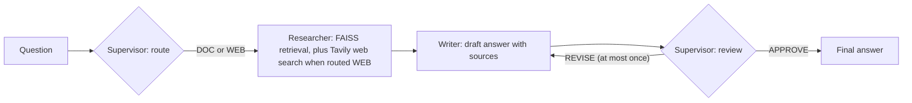

# DocMind Agent

[](https://github.com/HamzaAhmedSharif/Project-6-DocMind-Agent/actions/workflows/tests.yml)


A multi-agent retrieval-augmented question-answering system (LangGraph) **plus a measured answer to the question "does the multi-agent structure beat a single call?"** On a 20-question test set the three pipelines answer about equally well, while the multi-agent pipeline costs about 2.3-3.5 times the tokens and 2.9-3.9 times the API time of the baseline. The one thing only it can do is search the web, and its web answers have quality problems that are documented below. The tables in this README are generated from `evaluation/RESULTS.md` and checked by a test; figures quoted in the text are copied from those tables.

## What it does

Ask a question about an indexed PDF. A **supervisor** decides whether the question needs current web information (`WEB`) or can be answered from the document (`DOC`). A **researcher** retrieves the most similar chunks from a FAISS index (local `all-MiniLM-L6-v2` embeddings) and, for `WEB` questions, three Tavily search results. A **writer** drafts an answer from that context and names its sources. The supervisor then **reviews** the draft against the same context and either approves it or asks for one revision.



The language model sits behind an OpenAI-compatible client (`agents/llm.py`) that paces requests against a provider's tokens-per-minute limit, reads the provider's retry hint and stops with a clear message on a daily quota, so the free tier of any compatible provider works. The evaluation used `openai/gpt-oss-120b` on Groq's free tier.

## Results

Three systems answered the same 20 questions about *Attention Is All You Need* (12 answerable from the paper, 4 that need the web, 4 whose answer is not in the paper):

- **Baseline**: the original single-call pipeline (answer only from the context, and say so when it is missing).
- **Single call, writer prompt**: the same retrieval and one call with the multi-agent writer prompt. This separates the effect of orchestration from the effect of prompt wording.
- **Multi-agent**: routing, retrieval (plus web search), writing and review.

Model `openai/gpt-oss-120b` (reasoning effort low) on Groq's free tier, temperature 0; retrieval with 150-word chunks, 25-word overlap, top-10 chunks. The block below is generated from `evaluation/RESULTS.md`, which also has per-question results and the paraphrase-review entries.

<!-- RESULTS:START -->
#### Answer quality

| Metric | Baseline (M2 prompt, 1 call) | Single call, writer prompt | Multi-agent |
|---|---|---|---|
| Answerable questions: key-fact coverage | 84.6% (22/26) | 88.5% (23/26) | 84.6% (22/26) |
| Answerable questions: coverage after paraphrase review (details in evaluation/RESULTS.md) | 92.3% (24/26) | 100.0% (26/26) | 96.2% (25/26) |
| Answerable questions: all key facts found | 9/12 | 9/12 | 8/12 |
| Answerable questions: multi-agent found more / same / fewer facts than this system (questions) | 2 / 8 / 2 | 0 / 11 / 1 | n/a |
| Not-in-paper questions: abstained | 4/4 | 4/4 | 4/4 |
| Web questions: said it could not answer | 3/4 | 3/4 | 0/4 |
| Web questions: routed to web search | n/a | n/a | 4/4 |
| Web questions: web results retrieved | n/a | n/a | 4/4 |
| Web questions: answer text contains a URL | n/a | n/a | 3/4 |
| Routing correct (all questions) | n/a | n/a | 20/20 |
| Reviewer requested a revision | n/a | n/a | 2/20 |

#### Cost per question (mean): questions that need no web search

| Metric | Baseline (M2 prompt, 1 call) | Single call, writer prompt | Multi-agent |
|---|---|---|---|
| Questions measured | 16 | 16 | 16 |
| calls | 1.0 | 1.0 | 3.1 |
| prompt_tokens | 2549 | 2559 | 5856 |
| completion_tokens | 159 | 197 | 298 |
| api_seconds | 2.1 | 1.7 | 6.1 |
| throttle_seconds | 16.9 | 17.6 | 41.7 |
| wall_seconds | 19.1 | 19.3 | 47.9 |

#### Cost per question (mean): questions that need web search

| Metric | Baseline (M2 prompt, 1 call) | Single call, writer prompt | Multi-agent |
|---|---|---|---|
| Questions measured | 4 | 4 | 4 |
| calls | 1.0 | 1.0 | 3.5 |
| prompt_tokens | 2533 | 2543 | 8991 |
| completion_tokens | 90 | 104 | 674 |
| api_seconds | 2.2 | 1.5 | 8.6 |
| throttle_seconds | 18.6 | 20.7 | 69.0 |
| wall_seconds | 20.9 | 22.3 | 81.7 |
<!-- RESULTS:END -->

### What the evaluation found

- **Answer quality is a tie within noise.** Strict key-fact coverage was 84.6%, 88.5% and 84.6% (22, 23 and 22 of 26 facts). After reviewing the strict misses, which counts correct paraphrases, it was 92.3%, 100% and 96.2%. One fact is 3.8 points, so the test set cannot rank the systems. The 8 review entries were proposed by an AI assistant, each with a quote that the script verifies against the saved answer, and are pending the author's confirmation.
- **Multi-agent costs 2-4 times as much.** Compared with the baseline it used 3.1 calls instead of 1, 2.3 times the prompt tokens (5,856 vs 2,549 on questions that need no web) and 2.9 times the API time (6.1 s vs 2.1 s); on web questions 3.5 times the tokens and 3.9 times the API time.
- **Only the multi-agent pipeline can use the web, and its web answers need checking.** Routing was correct on 20 of 20 questions (a small set with obvious cues). A manual spot-check of the four web answers found one verified correct (the citation count of the paper, which matches Wikipedia), two with errors (one presents the 2017 BLEU score as the most recent published result; one lists PaLM, announced in 2022, as a 2026 release) and one unverified. The correctness of web answers is not part of the automatic scores.
- **The reviewer rarely fired and did not clearly help.** It asked for a revision on 2 of 20 questions. In both, the final answer was still incomplete or wrong, and in one the revision put the reviewer's feedback into the answer text (a known bug, see Limitations).
- **The one real failure on answerable questions came from retrieval, not orchestration.** For "Which regularization techniques were used during training?" the retrieved context did not contain the evidence. The baseline invented an item ("attention-dropout"), the multi-agent pipeline said the document did not support more than dropout, and the single-call system stated "label smoothing" correctly although it was absent from the context, which suggests it answered from memory (`evaluation/grounding_check.py`).

Planned next: hybrid retrieval with reranking, a held-out document that the model cannot already know, and a fix for the reviewer leak followed by a rerun.

## Limitations

- **One famous document.** Models may answer from memory, and key-fact coverage cannot tell a grounded answer from a remembered one. A document published after the model's training cutoff is needed for a clean test.
- **Small test set.** 12 answerable questions and 26 key facts; each system was run once, so there is no estimate of run-to-run variation.
- **Rule-based scoring.** Strict patterns count correct paraphrases as misses; the paraphrase review is a transparent second view, not ground truth.
- **Tuned on the test questions.** Chunk size and top-k were chosen by a rule fixed in advance, but using the same questions that later score the answers, so reported context recall is optimistic.
- **Known bug, not fixed.** On a revision, the reviewer's feedback can appear in the final answer text. It was left unfixed so the evaluated code stays identical to the shipped code.
- **Free-tier model.** The provider allowed 8,000 tokens per minute; limits can change, so results are committed as files rather than expected to reproduce on demand.

## Quick start

```bash
git clone https://github.com/HamzaAhmedSharif/Project-6-DocMind-Agent.git
cd Project-6-DocMind-Agent
python -m venv .venv            # Python 3.10; activate it, then:
pip install -r requirements.txt
cp .env.example .env            # Windows: copy .env.example .env
```

Edit `.env`:

- `TAVILY_API_KEY` for web search (free tier).
- Hosted model (default): `HOSTED_BASE_URL`, `HOSTED_API_KEY`, `HOSTED_MODEL`, plus `HOSTED_RPM` and `HOSTED_TPM` from the provider's rate-limit page. `python scripts/check_llm.py` confirms the key works and prints the provider's limits.
- Local model instead: `LLM_PROVIDER=ollama` and `OLLAMA_MODEL` (an Ollama model with a context window of at least 8192 tokens). The local mode was not used in the evaluation.

Index a document and run the app:

```bash
# put a PDF in data/, then:
python agents/ingest.py
streamlit run app.py
```

Command line: `python scripts/ask_baseline.py` and `python scripts/ask_multi_agent.py`. If the Hugging Face hub is slow or unreachable, set `HF_HUB_OFFLINE=1` after the first run.

Tests (no API keys, GPU or network needed):

```bash
pip install -r requirements-ci.txt
python -m pytest -q
```

Reproduce the evaluation (`data/transformer_paper.pdf` is arXiv 1706.03762 and is not included in the repository):

```bash
python evaluation/validate_questions.py   # every key fact is present in the paper
python evaluation/retrieval_grid.py       # offline retrieval check and settings selection
python evaluation/run_comparison.py       # live LLM; saves after every call and resumes; refuses to resume if code or settings changed
python evaluation/report.py               # writes evaluation/RESULTS.md
python scripts/sync_readme.py             # refreshes the results block in this README
```

## Repository layout

```
agents/       supervisor, researcher, writer, graph, state; llm.py (pacing, retries); ingest, retriever, rag_chain (baseline)
evaluation/   questions, scoring, run_comparison, report, retrieval_grid, grounding_check, adjudication; RESULTS.md; results/ (raw runs)
scripts/      ask_baseline, ask_multi_agent, check_llm, smoke_app, sync_readme
tests/        offline pytest suite (scripted fakes; no keys, GPU or network)
app.py        Streamlit UI
DECISIONS.md  decisions and engineering notes, each with its evidence
```

## Decisions and engineering notes

`DECISIONS.md` records the decisions with their evidence and the bugs found along the way. A few examples:

- A scoring bug (typographic hyphens and spaces) hid a tie between systems; it was found by auditing raw answers and fixed without loosening any expected-answer pattern.
- The provider limit that actually bound was tokens per minute, not requests, which led to token-bucket pacing instead of a fixed sleep.
- Chunk size and top-k were chosen by a rule fixed before any answer was scored.
- A report row labelled "cites URLs" actually measured retrieval; it was renamed and a separate text-based row was added.

## How this was built

Built with AI assistants under the author's direction: design and review with Claude, execution by an operator agent running reviewed plans. All reported numbers are produced by the scripts in `evaluation/`, and a test checks the results block in this README against `evaluation/RESULTS.md`.

## License

MIT, see `LICENSE`. Author: Hamza Ahmed Sharif.
